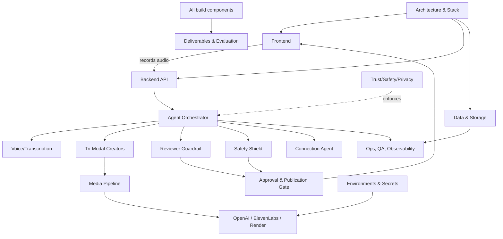

# HistorAI — Component Outline

> "When I Was Your Age" — Bridging Generational Wisdom & Purpose Through Agentic AI
> UMass Boston · 2026 PEAAII Agentic AI Applications Hackathon

This folder is the **single source of truth for every component** the HistorAI product is
made of. Each component is an atomic, buildable unit with a stable ID. The `/plan` folder
turns these components into concrete, tracked plans with To-Dos and acceptance criteria.

**This is an outline, not an implementation plan.** Detailed To-Dos and acceptance criteria
live in `/plan`. Component entries here capture purpose, responsibilities, interfaces,
dependencies, and risks.

---

## 1. How to read this outline

- **Component ID** — `C-<DOMAIN>-<NN>` (e.g. `C-AG-02`)
- **Build Phase** — `P1`–`P5` from the 1-week plan, `X` cross-cutting, `B` business/deliverable
- **Status** — `outline` (default) → `planned` → `in-progress` → `done` (updated by `/plan`)
- Each domain file uses the same component schema:
  `Purpose · Responsibilities · Interfaces · Inputs→Outputs · Dependencies · Tech · Phase · Acceptance Signals · Risks`

## 2. Domain files

| File | Domain | Contents |
|------|--------|----------|
| `01-architecture-and-stack.md` | Architecture | System topology, event pipeline, repo layout, environments |
| `02-frontend.md` | Frontend | Senior UX, youth hub, media player, chat, design system |
| `03-backend-and-orchestration.md` | Backend | FastAPI gateway, services, orchestrator, jobs, repositories |
| `04-agents.md` | Agents | All 10 autonomous agents + workflow engine + memory |
| `05-data-and-storage.md` | Data | Postgres schema, auth/roles, buckets, RLS/consent, audit |
| `06-media-pipeline.md` | Media | Audio normalization, podcast stitching, video render, articles |
| `07-integrations.md` | Integrations | OpenAI, Whisper, Moderation, TTS, ElevenLabs, Creatomate, Supabase |
| `08-trust-safety-privacy.md` | Trust | Grounding, HITL, moderation, PII, failure handling, crisis, metrics |
| `09-business-and-gtm.md` | Business | Evidence base, TAM/SAM/SOM, competition, monetization, roadmap |
| `10-deliverables-and-evaluation.md` | Deliverables | GitHub, demo, evaluation matrix, deck, responsible AI, survey |
| `11-ops-qa-and-devops.md` | Ops/QA | Secrets, local dev, CI/CD, observability, tests, mock fallback |

## 3. Master component map

### Architecture & Platform

| ID | Component | Phase | Depends on |
|----|-----------|-------|------------|
| `C-AR-01` | System architecture & multi-agent pipeline | P1 | — |
| `C-AR-02` | Event-driven workflow orchestration | P1 | C-AR-01, C-BE-07 |
| `C-AR-03` | Tech stack, repo & module layout | P1 | C-AR-01 |
| `C-AR-04` | Environment topology (local / staging / prod) | P1 | C-AR-03, C-OPS-01 |

### Frontend

| ID | Component | Phase | Depends on |
|----|-----------|-------|------------|
| `C-FE-01` | App shell, routing & layout (`/senior`, `/youth`) | P1 | C-AR-03, C-FE-08 |
| `C-FE-02` | Senior "Zero-Friction Storyteller Mode" UI | P2 | C-FE-01, C-FE-03 |
| `C-FE-03` | Voice recording & browser media capture | P2 | C-FE-01, C-BE-03 |
| `C-FE-04` | Youth "Wisdom Hub" media feed | P3 | C-FE-01, C-BE-04 |
| `C-FE-05` | Tri-modal media player (Article / Podcast / Video) | P3 | C-FE-04, C-MEDIA-* |
| `C-FE-06` | Connection & penpal chat UI | P4 | C-FE-04, C-BE-06 |
| `C-FE-07` | Design system, accessibility & i18n | P1 | C-FE-01 |
| `C-FE-08` | Auth, roles & onboarding | P1 | C-DATA-02 |

### Backend & Orchestration

| ID | Component | Phase | Depends on |
|----|-----------|-------|------------|
| `C-BE-01` | FastAPI application & API gateway | P1 | C-AR-03, C-DATA-01 |
| `C-BE-02` | Prompt & matching service | P2 | C-BE-01, C-AG-01 |
| `C-BE-03` | Voice input endpoint | P2 | C-BE-01, C-AG-02, C-DATA-03 |
| `C-BE-04` | Tri-modal generation orchestrator | P3 | C-BE-01, C-AG-09 |
| `C-BE-05` | Review → approval → publication state machine | P4 | C-BE-01, C-AG-06, C-TRUST-03 |
| `C-BE-06` | Chat / safety send endpoint | P4 | C-BE-01, C-AG-07 |
| `C-BE-07` | Background job queue & scheduler | P1/P3 | C-AR-02 |
| `C-BE-08` | Data access layer & repositories | P1 | C-DATA-01 |
| `C-BE-09` | Shared types & data contracts | P1 | C-DATA-01 |

### Agents

| ID | Component | Phase | Depends on |
|----|-----------|-------|------------|
| `C-AG-01` | Prompt refinement & routing agent | P2 | C-INT-01, C-AG-10 |
| `C-AG-02` | Voice transcription & metadata extraction agent | P2 | C-INT-02, C-AG-10 |
| `C-AG-03` | Article agent | P3 | C-INT-01, C-TRUST-01 |
| `C-AG-04` | Podcast agent | P3 | C-INT-01, C-INT-05, C-MEDIA-02 |
| `C-AG-05` | Video agent | P3 | C-INT-06, C-MEDIA-03 |
| `C-AG-06` | Reviewer / grounding guardrail agent | P4 | C-INT-01, C-TRUST-01/05 |
| `C-AG-07` | Safety moderation & PII shield agent | P4 | C-INT-03, C-TRUST-04/05 |
| `C-AG-08` | Connection / penpal matching agent | P4 | C-INT-01, C-BE-06 |
| `C-AG-09` | Agent orchestrator / workflow engine | P3 | C-AR-02, C-AG-01..08 |
| `C-AG-10` | Memory & context store | P2 | C-DATA-01 |

### Data & Storage

| ID | Component | Phase | Depends on |
|----|-----------|-------|------------|
| `C-DATA-01` | Postgres schema (users, prompts, stories, media_outputs, messages) | P1 | C-AR-03 |
| `C-DATA-02` | Supabase Auth & role model | P1 | C-DATA-01 |
| `C-DATA-03` | Storage buckets (raw-audio, processed-audio, video-reels) | P1 | C-DATA-01 |
| `C-DATA-04` | Row-level security, visibility & consent model | P1/P4 | C-DATA-01/02 |
| `C-DATA-05` | Evaluation, moderation & audit log tables | P4 | C-DATA-01, C-TRUST-09 |

### Media Pipeline

| ID | Component | Phase | Depends on |
|----|-----------|-------|------------|
| `C-MEDIA-01` | Audio intake, denoise & normalization (`ffmpeg`) | P3 | C-INT-06 |
| `C-MEDIA-02` | Podcast stitching (AI intro/outro + senior audio) | P3 | C-MEDIA-01, C-INT-05 |
| `C-MEDIA-03` | Video / audiogram render + captions | P3 | C-MEDIA-01, C-AG-05 |
| `C-MEDIA-04` | Article rendering (Markdown → HTML / PDF anthologies) | P3 | C-AG-03, C-FE-05 |

### Integrations

| ID | Component | Phase | Depends on |
|----|-----------|-------|------------|
| `C-INT-01` | OpenAI GPT-4o (reasoning, extraction, generation) | P2 | C-OPS-01 |
| `C-INT-02` | OpenAI Whisper (speech-to-text + timestamps) | P2 | C-OPS-01 |
| `C-INT-03` | OpenAI Moderation API | P4 | C-OPS-01 |
| `C-INT-04` | OpenAI TTS / Realtime (optional voice loop) | P4+ | C-OPS-01 |
| `C-INT-05` | ElevenLabs API (AI host voice) | P3 | C-OPS-01 |
| `C-INT-06` | Creatomate / Shotsack or `ffmpeg` render backend | P3 | C-OPS-01 |
| `C-INT-07` | Supabase SDK (DB, Auth, Storage, Realtime) | P1 | C-DATA-01/02/03 |

### Trust, Safety & Privacy

| ID | Component | Phase | Depends on |
|----|-----------|-------|------------|
| `C-TRUST-01` | Extractive grounding guardrail | P4 | C-INT-01 |
| `C-TRUST-02` | Reviewer scoring & auto-approve/hold policy | P4 | C-AG-06 |
| `C-TRUST-03` | Human-in-the-loop 1-tap consent & publication gate | P4 | C-FE-02, C-BE-05 |
| `C-TRUST-04` | Real-time safety moderation & interception | P4 | C-AG-07 |
| `C-TRUST-05` | PII detection & redaction | P4 | C-INT-01/03 |
| `C-TRUST-06` | Failure handling & strict publication block | P4 | C-BE-05 |
| `C-TRUST-07` | Crisis escalation & helpline routing (988 / ElderCare) | P4 | C-AG-07 |
| `C-TRUST-08` | Data ownership & visibility controls | P4 | C-DATA-04 |
| `C-TRUST-09` | Trust & robustness evaluation harness | P5 | C-AG-06/07, C-DATA-05 |

### Business & GTM

| ID | Component | Phase | Depends on |
|----|-----------|-------|------------|
| `C-BIZ-01` | Problem & research evidence base | B | — |
| `C-BIZ-02` | Market sizing (TAM / SAM / SOM) | B | C-BIZ-01 |
| `C-BIZ-03` | Competitive analysis & positioning | B | C-BIZ-01 |
| `C-BIZ-04` | Freemium model & unit economics | B | C-BIZ-02/03 |
| `C-BIZ-05` | GTM & "Crossing the Chasm" roadmap | B | C-BIZ-02/03/04 |

### Deliverables & Evaluation

| ID | Component | Phase | Depends on |
|----|-----------|-------|------------|
| `C-DEL-01` | GitHub repository & runnable code | P5 | all P1–P4 |
| `C-DEL-02` | End-to-end demo workflow | P5 | C-DEL-01, C-OPS-06 |
| `C-DEL-03` | Evaluation matrix (expected / actual / behaviors / limitations) | P5 | C-TRUST-09 |
| `C-DEL-04` | 11-slide pitch deck & speaker scripts | B | C-BIZ-*, C-DEL-02/03 |
| `C-DEL-05` | Responsible AI governance narrative | B | C-TRUST-* |
| `C-DEL-06` | Validation survey & customer discovery | B | C-BIZ-05 |

### Ops, QA & DevOps

| ID | Component | Phase | Depends on |
|----|-----------|-------|------------|
| `C-OPS-01` | Config & secrets management | P1 | C-AR-04 |
| `C-OPS-02` | Local dev & Docker Compose | P1 | C-AR-03 |
| `C-OPS-03` | CI/CD pipeline | P1/P5 | C-OPS-02 |
| `C-OPS-04` | Observability, logging & metrics | P3/P4 | C-AR-02 |
| `C-OPS-05` | Test suite (unit / integration / e2e) | P5 | C-AR-03 |
| `C-OPS-06` | Mock data & demo fallback safety net | P5 | C-DATA-01, C-OPS-02 |

**Component count: 73** (4 architecture, 8 frontend, 9 backend, 10 agents, 5 data,
4 media, 7 integrations, 9 trust, 5 business, 6 deliverables, 6 ops).

## 4. Dependency graph (high level)

## 5. Conventions

- **IDs are permanent.** Plans reference component IDs so traceability survives renames.
- **One component = one responsibility.** If an entry needs "and" in its purpose, split it.
- **Acceptance criteria live in `/plan`**, keyed by component ID, not here.
- **Phases mirror the 1-week plan:** P1 Foundation → P2 Voice → P3 Tri-Modal → P4 Guardrails → P5 Integration/Demo.
- **Status is tracked in `/plan/README.md`,** not duplicated in this folder.

## 6. Next step

With this component map approved, we move to `/plan`, where each component (and each
cross-cutting deliverable) gets a dedicated plan file with To-Dos and acceptance criteria.
See `/plan/README.md` for the plan index and the order we will work through them.
