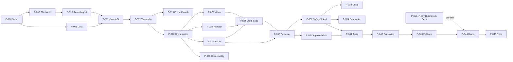

# HistorAI — Delivery Roadmap

Two coordinated tracks run in parallel:
- **Build track (Dev A & Dev B):** the working agentic product and demo.
- **Business track (all):** research, market, deck, and evaluation narrative.

This roadmap maps the 1-week / 30-person-hour feasibility scope and the 5 build phases
from the README to the plans in the index. It is the recommended **execution order**.

---

## 1. Build phases (from the 1-week plan)

| Phase | Focus | Person-hours | Plans |
|-------|-------|--------------|-------|
| **P1** | Setup & Foundation | 6 | P-000, P-001, P-002 |
| **P2** | Voice Input & Transcription | 6 | P-010, P-011, P-012, P-013 |
| **P3** | Tri-Modal Generation Engine | 10 | P-020–P-024 |
| **P4** | Guardrail & Safety Agents | 5 | P-030–P-034 |
| **P5** | Integration, Testing & Demo | 3 | P-040–P-045 |

The build phases total 30 person-hours (2 people × 15 h). The business track
(P-050–P-057) runs alongside and does not consume build hours.

---

## 2. Recommended execution order

**Critical path:** P-000 → P-001 → P-011 → P-012 → P-020 → (P-022 / P-023) → P-024 →
P-030 → P-031 → P-041 → P-042 → P-043 → P-044 → P-045.

---

## 3. Suggested day-by-day (2 people)

| Day | Dev A | Dev B | Business |
|-----|-------|-------|----------|
| **Day 1** | P-000, P-001 | P-000, P-002 | P-050 research started |
| **Day 2** | P-011, P-012 | P-010 | P-051/P-052 |
| **Day 3** | P-013, P-020 | P-024 (early wireframe) | P-053/P-054 |
| **Day 4** | P-021, P-022, P-023 | P-024, P-040 | P-055 draft |
| **Day 5** | P-030, P-031 | P-032, P-034 | P-056/P-057 |
| **Day 6** | P-033, P-041, P-042 | P-041, P-043 | P-055 rehearsal |
| **Day 7** | P-043, P-044, P-045 | P-044, P-045 | Final deck + Q&A |

---

## 4. Milestones & gates

| Milestone | Gate to pass | Plans |
|-----------|--------------|-------|
| **M1 — Foundation ready** | Both devs run the stack; schema + auth live | P-000, P-001, P-002 |
| **M2 — Voice captured & transcribed** | Record → transcript + metadata works | P-010–P-013 |
| **M3 — One input → three formats** | Article + Podcast + Video generated | P-020–P-024 |
| **M4 — Trust gates enforced** | No publish without review + consent; scam blocked | P-030–P-034 |
| **M5 — Demo-ready** | E2E runs with fallback; evaluation matrix filled | P-040–P-045 |
| **M6 — Pitch-ready** | Deck, scripts, QR codes, Q&A ready | P-050–P-057 |

---

## 5. Scope guardrails

**Must ship (MVP):** single-tap recording, Whisper transcript, 3 media formats, reviewer
grounding score, 1-tap senior approval, real-time scam block, youth feed, evaluation.

**Deferred (documented in index):** realtime two-way voice, multilingual dubbing, PDF
anthology export, institution admin portal.

**Golden KPI to protect:** 1 voice memo → 3 polished formats in **< 60 seconds**, and
**0** unapproved files published.

---

## 6. Traceability

Every milestone maps to plans; every plan maps to `/component` IDs; every component is
either planned or explicitly deferred. That chain is what we will walk together, plan by
plan, starting with **P-000**.
